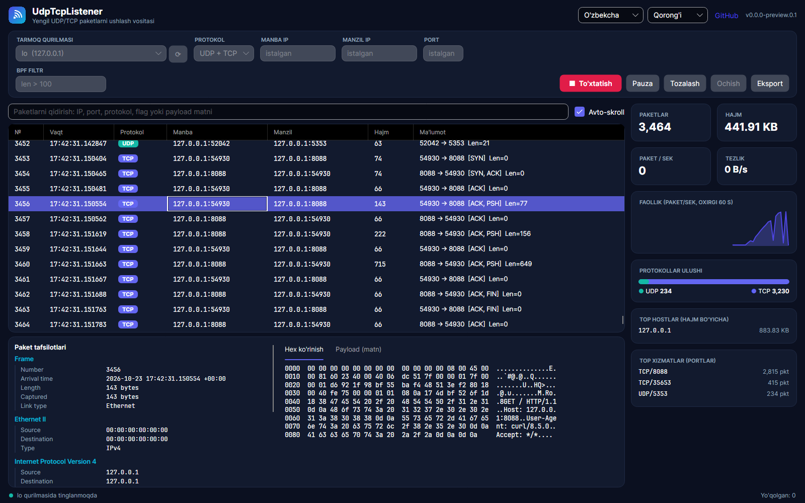
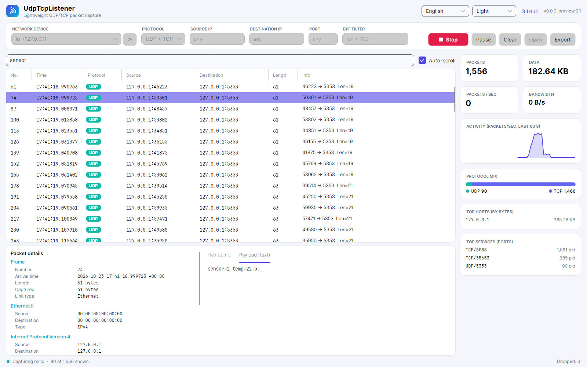

<p align="center">
  
</p>

<h1 align="center">UdpTcpListener</h1>

<p align="center">
  A fast, friendly UDP/TCP packet capture tool for <b>Windows</b> and <b>Linux</b>, with a modern desktop UI, a scriptable CLI and automatic updates.
</p>

<p align="center">
  <a href="https://github.com/shaxboz1011/UdpTcpListener/actions/workflows/ci.yml"></a>
  <a href="https://github.com/shaxboz1011/UdpTcpListener/releases/latest"></a>
  <a href="LICENSE"></a>
  
</p>

<p align="center">
  <b>English</b> · <a href="README.uz.md">O'zbekcha</a>
</p>



## Features

- **Live packet list.** It stays smooth with hundreds of thousands of rows. UDP and TCP are colour-coded, and TCP flags (SYN, ACK, PSH, FIN…) are shown.
- **Kernel-level filters.** Filter by protocol, source/destination IP (IPv4 and IPv6) and port. Advanced users can add a raw BPF expression.
- **Instant search** across IPs, ports, protocols, flags and payload text.
- **Packet details.** Each packet is broken down layer by layer (Frame → Ethernet → IP → UDP/TCP), with a hex dump and a payload-as-text view.
- **Live dashboard.** It shows packets/sec, bandwidth, a 60-second activity chart, the protocol mix, top hosts and top services.
- **Export** to **PCAP** (open it in Wireshark), CSV, JSON or a plain-text log. You can also **open** existing `.pcap` files.
- **Works on any link layer:** Ethernet, Wi-Fi, loopback, VPN/tun and Linux `any`.
- **Light/dark themes** and **three languages:** O'zbekcha, Русский and English.
- **Self-updating.** Installed copies check GitHub Releases, download only the delta and restart into the new version with one click.
- **CLI** for servers and scripts: `udptcplistener -i eth0 -p udp --port 53 -o dns.pcap`.



## Install

Download the latest release from the **[Releases page](https://github.com/shaxboz1011/UdpTcpListener/releases/latest)**.

| Platform | Desktop app | Command line |
|---|---|---|
| Windows 10/11 (x64) | `UdpTcpListener-win-Setup.exe` | `udptcplistener-cli-*-win-x64.zip` |
| Linux (x64) | `UdpTcpListener.AppImage` | `udptcplistener-cli-*-linux-x64.tar.gz` |

The desktop app updates itself. When a new version is published you'll see a banner with an **Update & restart** button.

### Requirements

Packet capture needs a capture driver and elevated rights:

- **Windows**: install **[Npcap](https://npcap.com/#download)** and tick *"Install Npcap in WinPcap API-compatible Mode"*. Npcap's licence doesn't allow it to be bundled, so the app shows a download link if it is missing.
- **Linux**: install libpcap (`sudo apt install libpcap0.8`, `sudo dnf install libpcap`). Then either run as root, or give the binary capture rights once:

  ```bash
  # CLI
  sudo setcap cap_net_raw,cap_net_admin=eip ./udptcplistener

  # Desktop AppImage (AppImages cannot keep file capabilities, so run it with sudo)
  sudo -E ./UdpTcpListener.AppImage
  ```

## Command line

```text
udptcplistener [options]

  -l, --list               List capture devices and exit
  -i, --interface <n>      Device index (from --list) or device name
  -p, --protocol <p>       udp | tcp | both (default: both)
      --src <ip>           Only packets from this IP
      --dst <ip>           Only packets to this IP
      --port <n>           Only packets where either side uses this port
  -f, --filter <bpf>       Extra BPF expression, e.g. "len > 100"
  -o, --output <file>      .pcap .csv .json or .txt (default: <timestamp>.txt)
  -c, --count <n>          Stop after n packets
  -q, --quiet              Do not print packets to the console
```

If you run it without `--interface`, it asks for the device and filters interactively, like the original tool.

## Build from source

You need the [.NET 10 SDK](https://dotnet.microsoft.com/download).

```bash
git clone https://github.com/shaxboz1011/UdpTcpListener.git
cd UdpTcpListener
dotnet test --solution UdpTcpListener.slnx           # unit tests
dotnet run --project src/UdpTcpListener.App          # desktop app
dotnet run --project src/UdpTcpListener.Cli -- -l    # CLI
```

### Project layout

```text
src/
  UdpTcpListener.Core/   capture engine, decoder, BPF filter builder, exporters, statistics (no UI)
  UdpTcpListener.App/    Avalonia desktop app (MVVM, CommunityToolkit.Mvvm, Velopack updates)
  UdpTcpListener.Cli/    command-line tool
tests/
  UdpTcpListener.Core.Tests/
```

## Releasing

Start a release in either of these two ways:

- **From GitHub:** go to **Actions → Release → Run workflow** on `main` and enter a version, e.g. `1.0.0`. The workflow creates the `v1.0.0` tag for you.
- **From git:** `git tag v1.0.0 && git push origin v1.0.0`

GitHub Actions does the rest: it runs the tests, packages Windows and Linux with Velopack, publishes the GitHub Release and attaches the CLI archives. Existing installs then update themselves.

Tags such as `v1.1.0-beta.1` become pre-releases and are not offered to stable users. See [docs/RELEASING.md](docs/RELEASING.md).

## Roadmap

See [docs/ROADMAP.md](docs/ROADMAP.md). Highlights: conversations and "follow stream", a UDP/TCP sender and replay tool, protocol decoders (Modbus, MQTT, custom), alerts and webhooks, and a remote capture agent.

## Contributing

Contributions are welcome, including translations. See [CONTRIBUTING.md](CONTRIBUTING.md).

## Legal

Only capture traffic on networks you own or are authorised to monitor.

## License

[MIT](LICENSE) © shaxboz1011 and contributors
