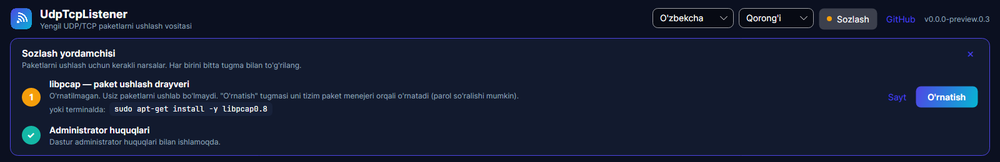

<p align="center">
  
</p>

<h1 align="center">UdpTcpListener</h1>

<p align="center">
  <b>Windows</b> va <b>Linux</b> uchun tez va qulay UDP/TCP paketlarni ushlash vositasi. Unda zamonaviy interfeys, CLI rejimi va avtomatik yangilanish bor.
</p>

<p align="center">
  <a href="README.md">English</a> · <b>O'zbekcha</b>
</p>


## Imkoniyatlar

- **Jonli paketlar ro'yxati.** Yuz minglab qatorda ham qotmaydi. UDP va TCP rang bilan ajratiladi, TCP flaglari (SYN, ACK, PSH, FIN…) ko'rsatiladi.
- **Yadro darajasidagi filtrlar.** Protokol, manba va manzil IP (IPv4/IPv6) hamda port bo'yicha filtrlash mumkin. Kerak bo'lsa, qo'shimcha BPF ifoda yozsa bo'ladi.
- **Tezkor qidiruv:** IP, port, protokol, flag va payload matni bo'yicha.
- **Paket tafsilotlari.** Har bir paket qatlamma-qatlam ko'rsatiladi (Frame → Ethernet → IP → UDP/TCP). Hex dump va payload'ni matn sifatida ko'rish ham bor.
- **Jonli dashboard:** paket/sek, tezlik, 60 soniyalik faollik grafigi, protokollar ulushi, top hostlar va top xizmatlar.
- **Eksport:** **PCAP** (Wireshark'da ochiladi), CSV, JSON yoki matnli log. Mavjud `.pcap` fayllarni **ochish** ham mumkin.
- **Istalgan tarmoq turida ishlaydi:** Ethernet, Wi-Fi, loopback, VPN/tun, Linux `any`.
- **Bitta tugma bilan sozlash.** Drayver o'rnatilmagan bo'lsa, ichki "Sozlash yordamchisi" uni o'zi o'rnatadi. Windows'da rasmiy Npcap o'rnatuvchisini yuklab olib imzosini tekshiradi, Linux'da libpcap'ni paket menejeri orqali o'rnatadi. Dasturni administrator sifatida qayta ishga tushirish ham mumkin.
- **Yorug'/qorong'i mavzu** va **3 til:** O'zbekcha, Русский, English.
- **O'zini o'zi yangilaydi.** O'rnatilgan dastur GitHub Releases'ni tekshiradi, faqat o'zgargan qismini yuklab oladi va bitta tugma bilan yangi versiyada qayta ishga tushadi.
- **CLI** server va skriptlar uchun: `udptcplistener -i eth0 -p udp --port 53 -o dns.pcap`.

## O'rnatish

Oxirgi versiyani **[Releases sahifasidan](https://github.com/shaxboz1011/UdpTcpListener/releases/latest)** yuklab oling.

| Platforma | Desktop ilova | Buyruq qatori (CLI) |
|---|---|---|
| Windows 10/11 (x64) | `UdpTcpListener-win-Setup.exe` | `udptcplistener-cli-*-win-x64.zip` |
| Linux (x64) | `UdpTcpListener.AppImage` | `udptcplistener-cli-*-linux-x64.tar.gz` |

Yangi versiya chiqqanda dastur ichida **"Yangilash va qayta ishga tushirish"** tugmasi bilan banner paydo bo'ladi.

### Talablar

Dasturdagi **"Sozlash"** tugmasi quyidagilarni bitta bosish bilan bajaradi:



Qo'lda bajarish uchun:

- **Windows:** **[Npcap](https://npcap.com/#download)** ni o'rnating va *"WinPcap API-compatible Mode"* ni belgilang. Npcap litsenziyasi uni dastur ichiga qo'shib tarqatishga ruxsat bermaydi. Shuning uchun u o'rnatilmagan bo'lsa, dastur yuklab olish havolasini ko'rsatadi.
- **Linux:** libpcap'ni o'rnating (`sudo apt install libpcap0.8`). So'ng dasturni root sifatida ishga tushiring yoki CLI'ga bir marta huquq bering:

  ```bash
  sudo setcap cap_net_raw,cap_net_admin=eip ./udptcplistener
  sudo -E ./UdpTcpListener.AppImage
  ```

## Manba koddan yig'ish

[.NET 10 SDK](https://dotnet.microsoft.com/download) kerak bo'ladi.

```bash
git clone https://github.com/shaxboz1011/UdpTcpListener.git
cd UdpTcpListener
dotnet test --solution UdpTcpListener.slnx
dotnet run --project src/UdpTcpListener.App
```

## Yangi versiya chiqarish

Release'ni ikki usulda boshlash mumkin:

- **GitHub orqali:** `main` branch'ida **Actions → Release → Run workflow** ni bosing va versiyani kiriting (masalan, `1.0.0`). Tag'ni workflow o'zi yaratadi.
- **git orqali:** `git tag v1.0.0 && git push origin v1.0.0`

GitHub Actions testlarni ishga tushiradi, Windows va Linux uchun paketlarni yig'adi va GitHub Release'ni e'lon qiladi. O'rnatilgan dasturlar shundan keyin avtomatik yangilanadi. Batafsil: [docs/RELEASING.md](docs/RELEASING.md).

## Hissa qo'shish

Har qanday yordam, jumladan tarjimalar ham, mamnuniyat bilan qabul qilinadi. [CONTRIBUTING.md](CONTRIBUTING.md) ga qarang.

## Huquqiy eslatma

Faqat o'zingizga tegishli yoki kuzatishga ruxsatingiz bor tarmoqlarda trafik ushlang.

## Litsenziya

[MIT](LICENSE) © shaxboz1011 va hissa qo'shuvchilar
