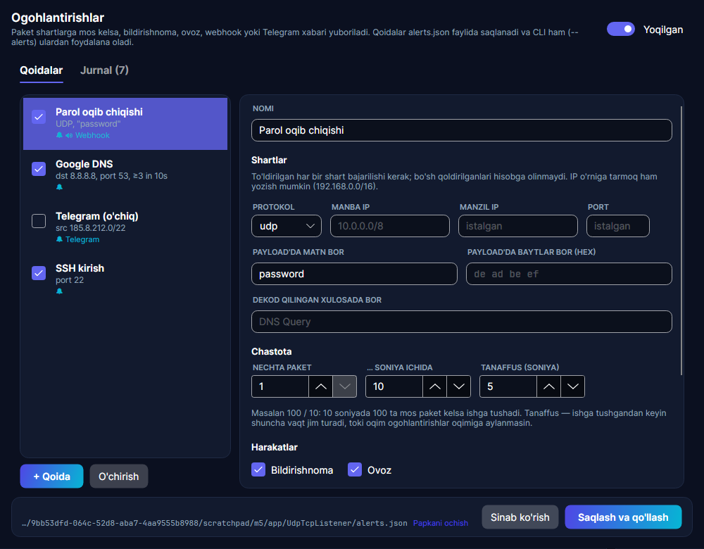

# Monitoring: alerts, process names and GeoIP

UdpTcpListener can watch traffic for you, tell you which application on your machine sent or received each packet, and show where public addresses are registered.



## Alerts

An alert rule says "when a packet matches these conditions (N times within T seconds), do these actions". Open the rules from the **Alerts** button in the toolbar. They are evaluated live while capturing, not when a file is opened.

### Conditions

Every condition you fill in must match; empty ones are ignored. A rule with no conditions matches every packet.

| Field | Meaning |
|---|---|
| `protocol` | `udp`, `tcp` or `any` |
| `source`, `destination` | An IP address or a network: `10.0.0.5`, `192.168.0.0/16`, `2001:db8::/32` |
| `port` | Either side uses this port |
| `payloadText` | The payload contains this text (case-insensitive) |
| `payloadHex` | The payload contains these bytes, e.g. `de ad be ef` |
| `decodedText` | The decoder summary contains this text, e.g. `DNS`, `Query A example.com`, `PUBLISH`, or the name of one of your [custom protocols](CUSTOM_PROTOCOLS.md) |
| `threshold`, `windowSeconds` | Fire only when this many matching packets arrive within this many seconds (default 1 within 10 s, i.e. every match) |
| `cooldownSeconds` | After firing, stay quiet for this long so a flood does not become a flood of alerts (default 30) |

### Actions

| Field | What happens |
|---|---|
| `notify` | A notification in the app's bottom-right corner. When the window is in the background, a desktop notification is also shown on Linux (`notify-send`); on Windows the taskbar button flashes. Click it to open the alert log. |
| `sound` | The system's alert sound |
| `webhookUrl` | An HTTP POST with a JSON body (see below) |
| `telegramBotToken` + `telegramChatId` | A message from your Telegram bot |

Failed deliveries (wrong URL, wrong token, no network) are shown as error notifications and in the log. The **Test** button sends a test message through the selected rule's channels and shows the result.

Webhook body:

```json
{
  "rule": "Password leak",
  "time": "2026-10-26T19:56:43.457+00:00",
  "protocol": "UDP",
  "source": "127.0.0.1:46536",
  "destination": "127.0.0.1:9999",
  "length": 77,
  "matches": 1,
  "decoded": "Text: login user=admin password=hunter2",
  "payloadHex": "6c6f67696e2075736572..."
}
```

`payloadHex` holds at most the first 1024 bytes. Point it at your own endpoint or at an automation tool such as n8n, Node-RED or Home Assistant. Chat services like Slack expect their own JSON shape, so they need such a tool in between.

### Telegram

1. In Telegram, talk to [@BotFather](https://t.me/BotFather), send `/newbot` and copy the token it gives you (`123456789:AA...`).
2. Send any message to your new bot (or add it to a group or channel).
3. Find the chat id: open `https://api.telegram.org/bot<token>/getUpdates` in a browser and look for `"chat":{"id":...}`. Group and channel ids are negative.
4. Paste both into the rule and press **Test**.

### The rule file

Rules are stored in `alerts.json` in the app's data folder (`%APPDATA%\UdpTcpListener` on Windows, `~/.config/UdpTcpListener` on Linux). The file is plain JSON, comments and trailing commas are allowed, and the CLI reads the same format:

```jsonc
[
  // Someone sends a password in clear text
  { "name": "Password leak", "protocol": "udp", "payloadText": "password", "sound": true,
    "webhookUrl": "https://example.com/hooks/udptcplistener" },

  // More than 100 DNS queries to one resolver in 10 seconds
  { "name": "DNS burst", "destination": "8.8.8.8", "port": 53, "threshold": 100, "windowSeconds": 10,
    "telegramBotToken": "123456789:AA...", "telegramChatId": "-1001234567890" },

  // Anything from a network you do not expect
  { "name": "Unexpected network", "source": "185.8.212.0/22", "enabled": false }
]
```

```bash
udptcplistener -i eth0 --alerts alerts.json -q                # watch quietly, print alerts
udptcplistener -r capture.pcapng --alerts alerts.json -q       # check an existing capture
```

The CLI prints each alert to stderr (with a terminal bell when `sound` is set) and sends its webhook and Telegram messages.

## Process names

The **Process** column shows which application on this computer owns the socket a packet belongs to, e.g. `firefox (4242)`. The Conversations tab shows it too, and you can type a process name into the search box. In the CLI, add `-P` / `--process`.

- **Windows** uses the system's TCP/UDP tables with owning process ids.
- **Linux** reads `/proc/net/{tcp,udp}[6]` and matches socket inodes in `/proc/<pid>/fd`. Processes of other users are only visible when capturing as root (which capturing usually needs anyway).
- Only traffic to or from this computer has a process. Forwarded traffic, other hosts' traffic seen in promiscuous mode, and packets of very short-lived sockets that closed before the lookup show no process.
- macOS is not supported yet.

## GeoIP / ASN

For public IP addresses the app can show the country (next to the address in the packet list, with a tooltip) and the network that owns it (ASN and organisation, in the packet details and the tooltip). Private, loopback, link-local and multicast addresses are skipped.

The lookup is offline. It uses the free **DB-IP Lite** country and ASN databases, which are updated monthly and licensed [CC BY 4.0](https://creativecommons.org/licenses/by/4.0/). IP geolocation by [DB-IP](https://db-ip.com).

- **App**: open **Setup** and click **Download** in step 3. The same button updates the database later.
- **CLI**: `udptcplistener geoip update`, then `udptcplistener -g ...` to annotate packets or `udptcplistener geoip 8.8.8.8 1.1.1.1` to look addresses up.
- **By hand** (e.g. offline machines): download `dbip-country-lite-YYYY-MM.csv.gz` and `dbip-asn-lite-YYYY-MM.csv.gz` from <https://db-ip.com/db/lite.php> and put them into the `geoip` folder in the app's data folder. Plain `.csv` files work too.
